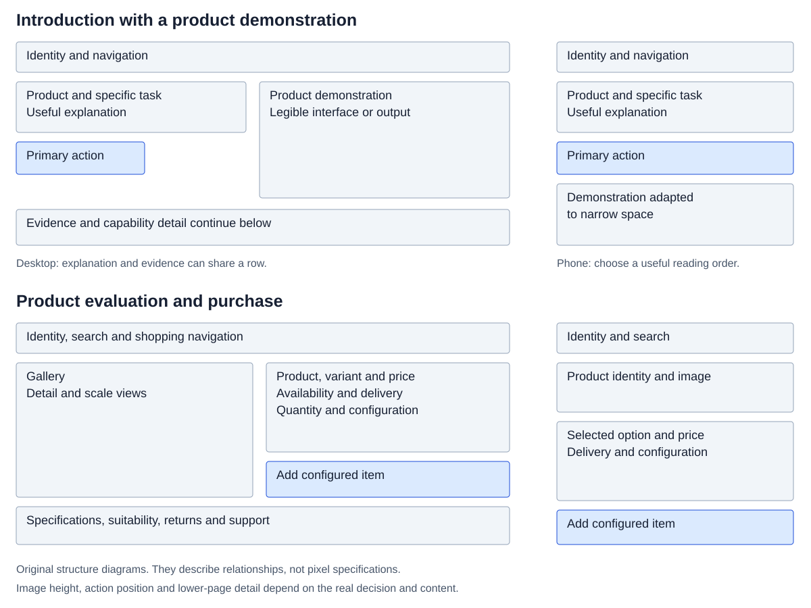
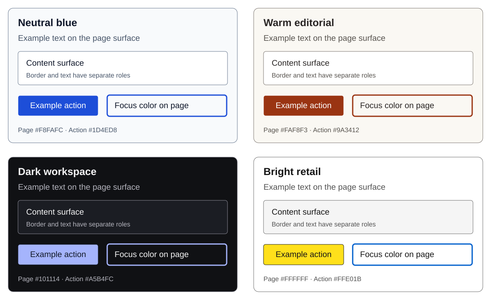

# Web UX/UI design guide

Research and working standards for marketing sites, web applications, and shops. Research dated 23 October 2026. Version 1.0.

This guide connects published research with direct observations of live websites. It defines practical starting points, explains when to change them, and gives a verification method. Use it with the [reference atlas](atlas.md), [verification workbook](workbook.md), and [source register](source-register.md).

## 1. Findings that change how we design

The most transferable pattern is a clear sequence: identify the task, provide the information needed for the next decision, make the action recognizable, and show its actual result. Visual identity can vary substantially around that sequence. Our live comparison includes dark software marketing, colorful financial software, a dense project-management demonstration, government search, product storytelling, and retail browsing.

| Question | Working answer | Evidence or qualification |
| --- | --- | --- |
| What belongs on the first screen? | Identity, a concrete purpose, the relevant next action, and enough product or service evidence to establish context. | Adapt to entry intent and page type; a returning app user needs their work. |
| Must everything fit above the fold? | Put orientation and the next useful action early. Continue the explanation below. | Viewport height, browser bars, zoom, and overlays change the fold. |
| Which layout wins? | Choose a layout around the information relationship: introduction plus demonstration, search plus categories, or product gallery plus purchase panel. | No universal winning layout was established by this research. |
| How many fonts? | Start with one family. Use two when the second has a distinct role. | A practical default, not a standards requirement. Code and language fallbacks are separate needs. |
| Which colors work? | Choose semantic roles and measure actual foreground/background pairs. | Brand fit and preference need contextual evaluation; hue alone predicts neither trust nor purchases. |
| Should we animate? | Use motion to explain a change, acknowledge input, or demonstrate a meaningful product behavior. | Essential information stays available without decorative motion. |
| Should we show a loader? | Provide feedback for actual waiting. Choose the indicator from what is known about the operation. | A branded entrance sequence is an additional delay. |
| Should we replace the cursor? | Keep the native pointer for ordinary navigation and transactions. | Specialized canvas tools may need a crosshair or brush preview. |
| What makes wording feel generic? | Unspecified benefits, interchangeable adjectives, repeated assurances, and labels that conceal the action. | These are content problems; wording alone cannot establish AI authorship. |
| Is a narrow screenshot sufficient? | Test layout, input, engine, OS, network, and accessibility settings separately. | Desktop WebKit emulation cannot verify actual iOS fonts, keyboard, or VoiceOver. |
| What should a shop optimize? | Correct product selection and successful, understood purchases. | Clicks and time on page can increase while purchase quality declines. |

### Evidence and scope

**Standards** define requirements within a stated scope. **Research** reports observations under particular methods and populations. **Platform guidance** describes a provider's system. **Live observations** show what a page did in our session. **Working defaults** are our proposed conventions. **Hypotheses** need validation with the intended audience.

We inspected ten URLs from nine organizations, with 36 initial page/profile combinations and eight additional IKEA combinations after rejecting optional cookies. The research includes desktop and phone captures for every URL; Linear, Basecamp, Apple, and IKEA's product page also received Android, desktop WebKit, and two tablet profiles. Patagonia returned an interstitial in desktop Chromium and a catalogue in phone WebKit. That difference remains an observation with an unknown cause.

The source review includes official accessibility and browser documentation, public Baymard research, Nielsen Norman Group research and guidance, company writing guidance, and Apple video transcripts. Three Apple videos also have inspected frame samples. Video viewing depth is recorded in the atlas. The earlier five-video skill foundation is retained as historical context, without claiming it was rewatched in this task.

These were public-page pattern studies. We did not conduct competitor security audits, place orders, enter personal data, measure conversion, or obtain real-user performance telemetry. No user project was selected or redesigned. Screenshots support the observed composition and captured state; they do not establish a complete accessibility or purchase-flow assessment.

## 2. Define the task before drawing the hero

Write a one-paragraph brief containing the audience, entry route, immediate task, primary action, useful evidence, constraints, and success condition. Record assumptions explicitly.

Example brief: “A first-time visitor arrives from a search for wall shelves. They need to find a shelf that fits a measured space and delivery budget. Show dimensions, materials, mounting requirements, available finishes, and delivery information. Success means selecting a suitable variant and understanding the total before committing.” This changes both the first screen and the catalogue cards.

For an application, specify whether the visitor is new, returning, waiting, blocked, or recovering from failure. A returning user usually benefits from recent work, current status, and direct actions. Repeating a marketing hero inside a workspace adds distance to the task.

**Research contribution:** NN/G's homepage guidance emphasizes recognizable identity, explicit purpose, useful examples, and routes onward. Its scrolling research shows that people do scroll while attention remains concentrated early; the reported percentages belong to the study's desktop conditions. [Homepage principles](https://www.nngroup.com/articles/homepage-design-principles/), [scrolling and attention](https://www.nngroup.com/articles/scrolling-and-attention/).

### First-screen priorities by page type

| Page | Information to establish early | Main action | Suitable evidence |
| --- | --- | --- | --- |
| Software marketing | Product category, specific job, intended user when relevant | Start, try a supported demo, or request a relevant sales conversation | Actual interface, output, or short task demonstration |
| Service business | Service, relevant location or eligibility, scope, next step | Request availability or a quote with clear expectations | Real work, credentials where relevant, and actual business identity |
| Portfolio | Person, role, specialization, selected work | View a project or contact | Work with context and the author's actual contribution |
| Shop homepage | Range, departments, search, genuine current offer | Search or enter a useful category | Products and recognizable category imagery |
| Category or search results | Category/query, result context, filters, sortable comparable products | Narrow, compare, or open an item | Consistent product information |
| Product page | Product identity, image, relevant variant, price and buying context | Select configuration and add the intended item | Detail, scale, material, fit, compatibility, and availability |
| Booking | What can be booked, location/date constraints, cost basis | Check availability | Real service information and terms affecting the choice |
| Authenticated app | Current work, relevant status, next task | Continue or create | User's actual records and state |

“Visible early” is a priority order, not a requirement to force every row into 600 pixels. A complex product may need substantial evaluation. Keep its identity recognizable while the visitor evaluates it.

### Decide the main action

Give the most relevant action the strongest treatment. A second route is useful when it represents a real difference in intent, such as a self-service account versus a sales conversation. Explain that difference through the label and surrounding content.

Make button wording match the actual next step. A button that opens a form should describe that form or request. An action that charges money needs the commitment and relevant cost context. Use links for navigation and buttons for actions; styling does not change those semantics.

For an unfamiliar product, show a real output or a legible demonstration. On a phone, a miniature full desktop screenshot often communicates visual character while explaining very little. Prefer a relevant crop, a mobile-specific example, or a short sequence that preserves truthful context.

## 3. Arrange the page around decisions

The following compositions are working recipes. Use actual content before tuning spacing.

The diagrams show information relationships. Choose actual image heights, spacing, and sequence using the content and the visitor's task.

### Introduction and demonstration

Desktop order: compact navigation; introduction and action beside a useful demonstration; relevant evidence; capability details; fit, pricing, or conditions; next action. Keep the headline, explanation, and action visually grouped. The demonstration may sit below when its width matters.

Phone order: identity and navigation; specific introduction; action; demonstration; evidence; detail. A visual can precede the text when it immediately identifies the product. Check the resulting distance to price or action at short viewport heights.

Use this for unfamiliar software, services, and portfolios. Linear's dark product demonstration and Basecamp's dense example show different implementations. Their composition is inspiration, not a causal conversion result. See the atlas for captured differences.

### Search and browse

Desktop order: identity and utilities; clear search; category navigation; useful selection or collection; product grid. Phone order: compact utilities; accessible search; concise category choices; products. Reduce oversized campaign imagery when it delays a shopping task that already has a clear intent.

A broad catalogue benefits from both search and browsing. Search serves a person who can name the item; categories support exploration and uncertain vocabulary. Keep both routes recognizable.

### Product and purchase

Desktop: gallery beside a purchase panel, then details, suitability, delivery/returns, and supporting evidence. Phone: identity and meaningful image, configuration and price, purchase action, then deeper evaluation. Adjust image height and ordering to the product, not to a generic full-screen template.

An optional sticky buying control must mirror the selected variant, price, and availability. It should never imply an unavailable option can be purchased. Inspect its overlap with consent, chat, browser bars, and the keyboard.

### Workspace

Use persistent orientation, task navigation, a content heading, contextual controls, and the work area. Reserve prominent banners for information that affects a decision. Keep frequent actions stable. Use progressive disclosure for infrequent configuration without hiding status, errors, or consequences.

### Arrangement rules worth retaining

- Align related edges and baselines. Deliberate alignment changes can mark a new content type.
- Put related elements closer together than unrelated groups. A label should be visibly attached to its control.
- Use size, weight, position, and contrast together to establish priority. Avoid making every element prominent.
- Give content the space needed for comprehension. Comparison tables may need density; an introduction may need separation.
- Use a small spacing scale as a production convention. A 4-unit base with larger steps can help; optical corrections remain valid.
- Let content determine layout breakpoints. Collapse columns when reading, comparison, or controls become awkward.
- Keep DOM order meaningful when CSS reorders a layout. Keyboard and screen-reader order must remain coherent.
- Show that content continues when the first composition could resemble a complete poster. A visible following section often supplies a better cue than a perpetual bouncing arrow.

NN/G describes scale, hierarchy, balance, contrast, and grouping as useful visual principles. Its F-pattern research explicitly describes multiple scanning behaviors. Neither F nor Z should become a universal page stencil. [Visual principles](https://www.nngroup.com/articles/principles-visual-design/), [F-pattern clarification](https://www.nngroup.com/articles/f-shaped-pattern-reading-web-content/).

### Layout defaults to test

| Element | Starting convention | Change it when |
| --- | --- | --- |
| Long reading text | Approximately 60–70 characters per line | Language, typeface, text size, or reading task warrants another measure |
| Page gutters | 16–24 CSS px on narrow layouts, increasing with space | Touch, safe areas, zoom, or content needs more |
| Main content width | A bounded container with fluid gutters | Data comparison or immersive media needs another arrangement |
| Body copy | Around 1rem, comfortable line height near 1.5 | The font's apparent size or audience requires enlargement |
| Heading wraps | Deliberate phrases with natural responsive wrapping | A forced line break creates awkward phone or translated text |
| Card grids | Enough width for the actual title, price, image, and state | Two narrow phone columns conceal information; use one column |

These numbers are conventions. Validate the result at enlarged text and with real content.

## 4. Typography: choose roles, then fonts

Start with **one family** for the interface. Add **one complementary family** when it contributes a distinct editorial or brand role. Treat **two families as the normal maximum for a simple page**, with a documented exception for code, mathematical notation, multilingual coverage, or a deliberate art direction. This is our maintainability rule; there is no universal research-backed maximum.

A font family can include many weights and optical sizes. A CSS fallback stack containing ten names does not mean the visitor sees ten unrelated fonts. Count the visible roles and actual downloaded resources. Our DOM samples found one principal declared family in Linear, Stripe, Basecamp, Notion, and IKEA; Mailchimp used distinct serif and sans-serif roles. Declared CSS families are not proof that a particular font file rendered every glyph.

### Selection method

1. Define roles: body, heading, label, metadata, price/number, and code where needed.
2. Test real language: product names, long navigation, Hungarian accents, currencies, dates, and errors.
3. Compare ambiguous characters such as I/l/1 and O/0 at the intended size and weight.
4. Check available weights, italics, numeral features, language coverage, license, and file size.
5. Inspect Windows and actual Apple rendering. A font can wrap or appear heavier across environments.
6. Test the fallback state and blocked font requests. Text must remain usable.

| Candidate | Suitable starting use | Decision to verify |
| --- | --- | --- |
| System UI stack | Operational apps, forms, compact tools | Native appearance and metrics differ by OS; test wrapping |
| Inter | UI, numbers, mixed software marketing | Its familiarity may need distinctive content and imagery; confirm deployed subset coverage |
| Atkinson Hyperlegible family | Interfaces where character distinction is a priority | Evaluate with intended readers; the name is not proof of universal superiority |
| A licensed text serif plus UI sans | Editorial, cultural, selected retail brands | Readability at small sizes, restraint in labels, and matching proportions |
| A brand's licensed custom family | Established identity with adequate language support | Web embedding rights, fallback metrics, and performance budget |

Inter's official site documents optical sizes, tabular figures, and its SIL Open Font License. Braille Institute describes Atkinson's emphasis on distinctive letterforms and permits commercial use. Keep the actual downloaded license in the project. [Inter](https://rsms.me/inter/), [Atkinson Hyperlegible](https://www.brailleinstitute.org/freefont/).

Google's typography guidance discusses relative sizing and readable measures; USWDS offers a range rather than one magic line length. Apple demonstrates why optical size and text scaling matter in native UI. Apply the principles to the web while using web sizing and accessibility behavior. [Web typography](https://web.dev/learn/design/typography), [USWDS](https://designsystem.digital.gov/components/typography/), [Apple typography video](https://developer.apple.com/videos/play/wwdc2020/10175/).

### Practical type decisions

Use consistent type roles. A heading can vary by viewport while retaining its role. Avoid a new arbitrary size for every card. Use proportional numerals for prose; tabular numerals can help aligned prices, measurements, timers, and tables when supported.

Use flexible height for labels and buttons. Avoid clipping ascenders, descenders, or accented capitals. Keep unit and currency relationships clear. Test strings such as “Árvíztűrő tükörfúrógép”, “ŐŰ őű”, “1 299 990 Ft”, and a long two-line product name.

Use `rem` and relative relationships for text. A fluid heading using `clamp()` still needs a zoom test; viewport units alone cannot be relied on for user resizing. Reserve all caps for established abbreviations and meaningful conventions. Decorative uppercase labels add little when a heading already identifies the section.

Font loading can delay visible text or shift layout when the fallback differs. Ship only useful resources, choose a loading strategy deliberately, and check the real fallback transition. Variable fonts can reduce some multiweight payloads, but the actual files determine the saving. [Font performance](https://web.dev/articles/font-best-practices).

## 5. Color: build a usable system

Choose color by role: page, surface, text, secondary text, action, action text, border, focus, selected state, success, warning, error, and disabled state. Brand colors can populate those roles after testing. A decorative accent and an error must remain distinguishable through shape, label, or icon.

The observed sites use substantially different palettes. That supports choosing for context; it does not establish that a particular hue creates trust or increases sales. A bright brand may need dark text on its action color. A dark workspace needs independent choices for text, borders, controls, images, and status.

**Requirements:** WCAG AA text contrast is generally at least 4.5:1, or 3:1 for qualifying large text, with specified exceptions. Essential control/state indicators and meaningful graphics generally require 3:1 against adjacent colors. Large text means 18pt regular or 14pt bold, approximately 24px or 18.67px. Keep the scope and exceptions intact. [Text contrast](https://www.w3.org/WAI/WCAG22/Understanding/contrast-minimum.html), [non-text contrast](https://www.w3.org/WAI/WCAG22/Understanding/non-text-contrast.html).

### Four original starting palettes

These are proposed role sets, not copied brand palettes or complete themes. Ratios below were calculated from opaque sRGB values using the WCAG relative-luminance formula. The underlying measurements are in [palette-contrast.csv](../assets/palette-contrast.csv). Passing these pairs does not verify all UI states, transparency, gradients, photographs, or a full page.

| Role | Neutral blue | Warm editorial | Dark workspace | Bright retail |
| --- | --- | --- | --- | --- |
| Page | #F8FAFC | #FAF8F3 | #101114 | #FFFFFF |
| Surface | #FFFFFF | #FFFFFF | #1B1D23 | #F5F5F5 |
| Main text | #0F172A | #292524 | #F4F4F5 | #161616 |
| Secondary text | #475569 | #57534E | #B4B4BD | #525252 |
| Action | #1D4ED8 | #9A3412 | #A5B4FC | #FFE01B |
| Action text | #FFFFFF | #FFFFFF | #111827 | #161616 |
| Focus on page | #1D4ED8 | #9A3412 | #A5B4FC | #005FCC |
| Control border on surface | #64748B | #78716C | #8A8A96 | #6B6B6B |
| Main text/page ratio | 17.06:1 | 14.29:1 | 17.18:1 | 18.10:1 |
| Secondary text/page ratio | 7.24:1 | 7.19:1 | 9.17:1 | 7.81:1 |
| Action text/action ratio | 6.70:1 | 7.31:1 | 8.90:1 | 13.73:1 |

Choose neutral blue for a broad operational starting point; warm editorial when the content and imagery support a warmer treatment; dark workspace when use conditions and preference justify it; bright retail when a vivid action accent fits the brand. These are aesthetic hypotheses. A yellow button may require a darker boundary for clear shape against white. The supplied focus color needs retesting against every adjacent component; use an offset or two-color focus treatment when one ring cannot cover all surfaces.

### Theme checks

- Inspect actual foreground/background pairs in hover, selected, focused, error, and loading states.
- Keep product photography's color trustworthy. Avoid filters that imply a different material or finish.
- Test text over the brightest and darkest relevant image crops and animation frames.
- Check charts and statuses without color. Labels and patterns preserve meaning.
- If dark mode is supported, follow the OS initially where appropriate and preserve an explicit user override.
- Treat light and dark palettes as separate mappings; invert-all filters are unsuitable for product images and many controls.
- Test Windows forced-colors behavior. Background fills and shadows may disappear.

NN/G's dark-mode user research identifies practical legibility problems and contexts where theme choice matters. It does not establish a universally healthier, more readable, or more premium mode. [Dark-mode research](https://www.nngroup.com/articles/dark-mode-users-issues/).

## 6. Images, icons, emoji, and backgrounds

Give each image a job: identify a product, show scale, demonstrate use, establish a real person, or explain a result. Use consistent crops for comparison while retaining access to details. A large decorative image can carry brand character, but it should earn the first-screen space it occupies.

Use a coherent icon family with compatible stroke, size, and optical weight. Center icons optically as well as geometrically. Pair unfamiliar icons with text. Give icon buttons an accessible name, a sufficiently large hit area, and visible focus. Decorative icons beside a complete label can be hidden from assistive technology.

### Emoji across platforms

Unicode defines characters and sequences; presentation varies across implementations. Skin tones, joined sequences, flags, variation selectors, and font support can alter rendering. A page that looks correct with Windows emoji may look different on iOS or show an unsupported sequence elsewhere. [Unicode Emoji standard](https://unicode.org/reports/tr51/).

For stable interface symbols, use a licensed SVG/icon asset with an explicit accessible name. Native emoji can suit expressive user content or deliberate brand details, provided meaning survives their variation. Do not use a colored emoji as the sole status signal. Check baseline, size, fallback boxes, dark backgrounds, and spoken labels on actual devices.

Variation selectors can request text or emoji presentation for supported characters; they do not guarantee identical artwork. Substituting image assets also creates license, download, and accessibility responsibilities.

### Background choices

| Treatment | Suitable use | Acceptance condition |
| --- | --- | --- |
| Solid surface | Forms, workspaces, product evaluation, most reading | Clear hierarchy and sufficient contrast |
| Static gradient or restrained texture | Brand identity or separating a region | Text stays readable; compression and scaling remain clean |
| Photography | Real product, location, service, or editorial context | Useful crop and accurate representation |
| Short controlled video | A process or physical behavior that benefits from motion | Poster, controls where required, readable overlays, and acceptable load cost |
| Pointer-reactive highlight | Optional desktop brand detail | No interception of input; native controls remain clear |
| Particles, parallax, WebGL scene | A deliberately experiential or demonstrative page | Measurable value, static fallback, motion controls, and performance budget |

Use one dominant expressive treatment as a starting convention. Competing movement, blur, floating badges, and cursor effects can consume attention without explaining anything. A restrained surface can still have distinctive typography, illustrations, composition, and content.

## 7. Loading states and perceived responsiveness

First distinguish **the response to input** from **completion of the operation**. A pressed state acknowledges an action. The saved, purchased, uploaded, or published state must reflect the actual result.

NN/G's progress guidance recommends immediate feedback, stronger waiting feedback as delays grow, and more informative progress for long operations. Its second-based guidance is a heuristic, not a deadline or a reason to slow a fast action. Apple's progress guidance distinguishes determinate and indeterminate work. [NN/G progress indicators](https://www.nngroup.com/articles/progress-indicators/), [Apple progress indicators](https://developer.apple.com/design/human-interface-guidelines/progress-indicators).

### State selection recipe

| Situation | Useful treatment | Recovery and meaning |
| --- | --- | --- |
| Immediate local action | Visible pressed/selected state | Preserve focus and acknowledge the changed value |
| Brief network request | Keep the current context; show local busy feedback if waiting becomes noticeable | Prevent duplicate consequential submissions |
| Predictable content structure | Stable skeleton with reserved geometry | Replace with content or a specific error; reduce shimmer motion |
| Known completed work | Real progress, such as files processed or bytes uploaded | Explain the denominator; allow cancellation when supported |
| Unknown duration | Named operation with indeterminate feedback | Honest stage, timeout/recovery path, and supported background continuation |
| Long export or AI job | Durable job status, result location, optional notification | Reconnect to the existing job; show partial and failed outcomes accurately |
| Refresh with usable cached data | Keep existing results with freshness/loading context | Distinguish stale from updated data |
| Failed save | Persistent error near the work | Say what remains unsaved and provide a safe retry |

Our initial implementation convention is to acknowledge input immediately and delay a nonessential spinner by roughly 200–300ms to avoid flashes on very fast requests. Tune this with actual latency and perception. Never hold completed content merely to finish a loader. A skeleton's benefit depends on layout predictability; it is a hypothesis to test, not a universal faster-feeling treatment.

For long tasks, separate upload, processing, validation, and result availability. Reaching 100% uploaded does not mean processing finished. Show an estimated time only when the system can support it. Use a step label when a percentage would be invented. Keep waiting text specific: the object and operation usually matter more than reassurance.

Payment and AI jobs need safe retries and a known job identity. A client timeout may leave the server running. Retrieve status before creating a duplicate paid operation. Completion copy must distinguish an order received from payment confirmed, and a generated draft from a reviewed output.

Expose meaningful status to assistive technology without announcing every animation frame. Keep failure visible long enough to act. A disappearing toast is insufficient for an unresolved save failure.

## 8. Animation and interaction feedback

Specify motion as a component behavior: purpose, trigger, affected properties, duration, easing, interruption behavior, and reduced-motion alternative. This makes animation reviewable.

NN/G's animation guidance discusses short feedback and longer transitions for larger changes, typically within a broad 100–500ms range. It also warns about repetition and motion discomfort. Treat that as a range to evaluate. Our default tokens below are narrower starting choices. [Animation execution](https://www.nngroup.com/articles/animation-duration/).

| Motion | Starting choice | Verify |
| --- | --- | --- |
| Hover/focus emphasis | Immediate state with optional 120–180ms transition | Focus remains obvious; touch has an equivalent action |
| Toggle or selection | Around 120–180ms | State is clear throughout; interruption produces the correct final state |
| Menu or small disclosure | Around 150–220ms | It opens promptly and supports keyboard dismissal |
| Drawer or modal | Around 180–280ms | Focus, scrolling, and closing work during rapid input |
| Item relocation | Short motion relating old and new position | The item does not become difficult to track |
| Repeated operation | Minimal or no decorative movement | Frequent work stays efficient |
| Scroll reveal | Optional enhancement | Content is present and usable if animation or JavaScript fails |
| Product demonstration | User-directed when possible | Controls, readable states, and meaningful alternatives |

Prefer effects that the rendering pipeline can handle efficiently; transform and opacity are useful starting points. Profile the actual page, especially large layers, filters, blur, and concurrent animations. Keep `will-change` selective. A CSS-only effect can still be expensive. [Web animation performance](https://web.dev/articles/animations-guide).

WCAG 2.2.2 at Level A addresses automatic moving content lasting over five seconds alongside other content, and automatic updating has its own conditions. WCAG 2.3.3, concerning disabling nonessential interaction-triggered motion, is Level AAA. Our default is to respect reduced-motion preferences across projects regardless of that distinction. A reduced-motion implementation does not automatically satisfy every pause/control requirement. [Pause, stop, hide](https://www.w3.org/WAI/WCAG22/Understanding/pause-stop-hide.html), [animation from interactions](https://www.w3.org/WAI/WCAG22/Understanding/animation-from-interactions.html).

For reduced motion, remove travel, parallax, large scaling, decorative looping, and cursor following. Preserve the resulting state and useful feedback. Avoid global hacks that accidentally prevent a component from completing because it waits for an animation event. Test the alternative behavior explicitly. Apple's Safari video demonstrates checking motion impact while adding web animation. [Safari/WebKit video, animation chapter](https://developer.apple.com/videos/play/wwdc2025/233/?time=106).

## 9. Custom cursors and pointer effects

Keep native cursor behavior for links, text entry, drag affordances, and ordinary controls. A native pointer supports familiar precision and user settings. Use a specialized cursor when it communicates the active tool, such as drawing, resizing, panning, or image inspection.

An optional decorative follower should preserve the native pointer, sit behind interaction, stop when inappropriate, and never carry the only label. Check it with zoom, keyboard input, reduced motion, forced colors, pointer exit, and a low-performance device. A magnetic button should not move away from the target the person is attempting to select.

Detect input capability rather than equating viewport width with a mouse. A large tablet may have touch, trackpad, keyboard, or all three. `hover` and `pointer` describe primary input capabilities; they are useful enhancement conditions, not a reason to remove alternative interaction routes. MDN also documents iPadOS cursor restrictions. [Hover](https://developer.mozilla.org/en-US/docs/Web/CSS/Reference/At-rules/@media/hover), [pointer](https://developer.mozilla.org/en-US/docs/Web/CSS/Reference/At-rules/@media/pointer), [cursor](https://developer.mozilla.org/en-US/docs/Web/CSS/Reference/Properties/cursor).

A candidate enhancement can be limited to `(hover: hover) and (pointer: fine)` and disabled under reduced motion. The page's meaning and controls should work outside that condition. Use native scrolling as the default. A branded scrolling system needs a concrete task benefit and extensive input testing.

## 10. Loading time and performance budgets

Google's current good Core Web Vitals thresholds are **LCP ≤2.5 seconds**, **INP ≤200 milliseconds**, and **CLS ≤0.1**, evaluated at the **75th percentile**, with mobile and desktop segmentation. All three matter. These measure important aspects of experience; they do not measure offer clarity, correct purchases, or every delay in a flow. [Web Vitals](https://web.dev/articles/vitals).

Use field data to understand users' experience and controlled lab runs to diagnose changes. Record URL versus origin scope, collection window, device, network, cache, and tool. Missing field data remains unknown. A normal Lighthouse navigation run does not measure field INP; TBT is a useful lab diagnostic with a different meaning.

### First-screen delivery

Put important text and layout in the earliest usable response. Make the likely LCP resource discoverable early. Avoid lazy-loading the main visible image. Use correctly sized responsive images, reserve dimensions, and defer secondary media. Investigate server response, resource discovery, download, and render delay separately. [LCP optimization](https://web.dev/articles/optimize-lcp).

For a simple marketing page or initial shop shell, an **illustrative starting budget** is: initial compressed transfer around 1MB or less; initial JavaScript around 200KB or less; the main image around 200KB or less; and initial fonts around 100KB or less. These are our proposed planning caps, not industry standards or guarantees. A multilingual font, detailed product image, or complex application may need a justified alternative. Preserve useful detail and measure on the intended hardware.

Avoid loading a video, 3D renderer, several font families, and multiple third-party overlays before the core task. Evaluate each resource by the decision or function it serves. Use static poster content while optional demonstrations load. Stop offscreen decorative animation where feasible.

### Measure the whole task

Measure time to useful content, first responsive action, search/filter response, image detail availability, validation feedback, save completion, and payment handoff. Include slow connection, CPU contention, failed requests, warm return visits, and back navigation. A fast first load can coexist with a stalled filter or a lost form.

The live reference screenshots in this study are **not a performance benchmark**. Their fixed capture delays, network conditions, animation phases, and different browser profiles do not support ranking the brands by speed.

## 11. Shops: support product finding and comparison

A shop has several distinct tasks: explore a range, locate an item, compare candidates, establish suitability, configure a purchase, review the order, pay, and obtain help afterward. Design each transition. Someone arriving directly at a product page may never see the homepage.

### Homepage and navigation

Use category names the audience understands. Show enough range to prevent a featured campaign from implying the shop sells only one type of item. Put search where a shopper can find it. Preserve category context in navigation, breadcrumbs, list titles, and back behavior.

Campaign art can introduce a collection. It should provide a useful destination and accurate offer conditions. A visitor who already knows their product should have a direct route around the campaign. A seasonal color treatment should preserve established shopping controls.

### Search and results

Handle the query visibly. Differentiate no matches, an unavailable item, a loading failure, and a filter combination that removed all results. Offer a relevant correction path: revise the query, remove a criterion, browse a related category, or retry. Keep the user's text.

Autocomplete needs clear categories of suggestion when it mixes products, queries, and departments. Support keyboard navigation and an escape route. Preserve a normal submit path. Avoid accepting a suggestion merely because it happened to be first when the person pressed Enter intending to search their complete phrase.

### Product-list cards

Design the card around what must be compared. The required content varies by category:

| Category | High-value comparison information |
| --- | --- |
| Furniture | Dimensions, material/finish, price, key configuration, delivery context |
| Apparel | Recognizable item, available colors, price, size/fit route, useful on-body imagery |
| Food/consumables | Pack quantity, unit price, relevant dietary facts, availability |
| Electronics | Model, critical specification, compatibility, price, configuration |
| Building materials | Selling unit, coverage, dimensions, material, quantity rules |
| Digital goods/subscriptions | Included capability, license/access scope, billing period, renewal |

Keep these facts in consistent positions. Reserve space for missing images and long titles. Include real rating count/context when reviews are available. A product name alone rarely answers size, fit, or compatibility questions.

Baymard's product-list research identifies confusion when variations are fragmented into separate items, and examines the value of additional views for evaluating products. Apply this to the actual catalogue; a technical parts list may need a different representation from apparel. [Product-list research](https://baymard.com/research-articles/current-state-product-list-and-filtering).

Use a visible color name as well as a swatch. Indicate additional options clearly. On touch, expose useful image controls without requiring hover. A quick-add action suits an item with a known valid configuration; an item requiring size or compatibility decisions needs those decisions first.

### Filtering

Show applied criteria near the results, let people remove one without rebuilding the entire query, and distinguish “clear all” from clearing one group. Explain exact versus minimum semantics. “At least four seats” and “four seats” describe different requests.

For mobile filter drawers, specify whether results update immediately or after Apply. Display the selected state and any supported result count accurately. Closing, applying, clearing, and navigating back must have distinct, predictable effects. Preserve scroll position when returning from an item.

Baymard's applied-filter research links visible selection summaries to feedback, removal, and list context. Its recommendation is especially useful when the filtering controls are collapsed. [Applied-filter research](https://baymard.com/research-articles/how-to-design-applied-filters).

Choose pagination, load-more, or continuous loading from the browsing task and catalogue size. Comparison and returning to an item require stable location and recoverable state. If continuous loading prevents reaching the footer, introduce a deliberate load boundary or another reliable route to footer information.

## 12. Product pages: resolve purchase uncertainty

The purchase panel should make it possible to answer: what is this, does it fit my need, which option am I selecting, what does it cost, can I receive it, and what happens if I need help or a return?

### Gallery and identity

Show a clear main image, useful alternate views, a detail view, and scale or in-use context where necessary. Provide discernible controls and selection feedback. Keep image loading stable. Ensure zoom and pinch behavior do not trap the visitor in the gallery.

Baymard's public product-page findings cover visible size choices, scale imagery, relevant product views, and price/policy information. These address uncertainty that attractive photography alone cannot resolve. [Product-page research](https://baymard.com/research-articles/current-state-ecommerce-product-page-ux).

For dimensions, show the measurement order and units. For furniture, mounting and assembly requirements can affect suitability. For materials, distinguish a physical item from a rendered visualization. If generated imagery could misrepresent texture, scale, or a real finish, explain its illustrative status and supply trustworthy product evidence.

### Options, price, and availability

Prefer visible choices for a manageable set of meaningful variants. A large set may need a searchable selector. Label unavailable options and explain the relevant next step. Avoid defaulting a consequential option without adequate context.

Selection should update the image, SKU, price, stock, and purchase action consistently. The displayed price must correspond to the selected configuration. A starting price needs a clear qualifier. Keep a unit price separate from a package price and the total for the chosen quantity.

Example: two fixed one-kilogram packages are two packages, not one two-kilogram product. A coverage calculator should explain units, waste, rounding, and the mapping to purchasable quantities. Test it against known cases and actual product rules.

### Delivery, returns, and proof

Show useful delivery information near the decision. If location is needed, explain why and request only what is needed for the estimate. Distinguish a dispatch promise from an arrival estimate. Represent returns using the business's real process and applicable rights; do not invent a convenient blanket policy.

Display genuine reviews with their relevant context. A new store can earn confidence through accurate specifications, business details, clear prices, real photographs, and a working support route. It does not need fabricated testimonials or stock badges.

For EU consumer sales, pricing information must be checked against current rules and the actual transaction. Your Europe explains total price, additional charges, and consent to optional payments. This guide does not determine every product's tax or cancellation treatment. [EU pricing and payments](https://europa.eu/youreurope/citizens/consumers/shopping/pricing-payments/index_en.htm).

### Mobile purchase panel

Our IKEA captures show the gallery dominating the short phone viewport, while desktop presents imagery and purchase details together. The transferable question is whether the mobile image earns its height for this product. Test a realistic buyer task before copying that order.

A sticky action can help after evaluation. Include enough identity to prevent acting on the wrong variant. Reserve space, preserve keyboard access, and account for the bottom safe area. Do not stack purchase, cookie, chat, and promotion bars until the usable content region disappears.

## 13. Cart, checkout, and post-purchase

### Cart

Show each item with its defining variant, quantity, unit/line cost, and availability. Make editing and removing clear; offer undo when suitable. Keep the total synchronized with confirmed changes. Explain a changed price or unavailable item without discarding the rest of the cart.

Make known delivery charges and commitments visible. When a charge depends on location, show that dependency and the route to calculate it. Keep coupon entry available without making a discount code appear necessary to complete the purchase.

### Checkout

Baymard's checkout guidance supports a prominent guest route, understandable progress, reasonable field effort, explicit next actions, and recoverable errors. Its population statistics and opportunity estimates should not be used as a promised uplift for our shop. [Checkout flow](https://baymard.com/blog/checkout-flow-ux-optimization), [checkout findings](https://baymard.com/research-articles/current-state-of-checkout-ux).

Use this flow specification as a starting point:

1. **Identity/contact:** explain whether the visitor is checking out as a guest or signing in. Request necessary contact information.
2. **Delivery:** choose location and supported fulfillment method; show the relevant price and timing.
3. **Payment:** offer actual supported methods and disclose redirection, financing, or recurring terms.
4. **Review/commitment:** present the final known order and a button matching the commitment.
5. **Confirmation:** show the actual order/payment state, reference, next step, and support route.

The steps can share a page. Reduce effort and uncertainty rather than optimizing only the number of screens. Back and edit actions should preserve valid information.

### Forms

Use persistent labels. Explain unfamiliar required information at the field. Apply autocomplete tokens and input modes appropriate to the actual data and country. A postal code is not universally numeric; phone and identifier fields can contain leading zeros and should not inherit numeric arithmetic behavior.

Validate at a useful moment. Avoid declaring an incomplete email invalid while the person is still typing it. On submission, identify the actual problem and preserve valid entries. Use an error summary with links for a form where several errors can be distant from the viewport. Keep summary and field wording consistent. [GOV.UK error-summary pattern](https://design-system.service.gov.uk/components/error-summary/).

Keep payment details in the payment provider's intended secure flow. Preserving input after a recoverable error does not authorize storing card numbers in application logs, browser storage, analytics, or a homegrown persistence layer.

### Confirmation and recovery

A return from a payment provider is not sufficient evidence that payment succeeded. The server must verify status. Show pending, paid, failed, cancelled, or refunded accurately. Explain whether a retry will resume the same attempt and provide a safe support path if the state is uncertain.

Design for changed stock, expired sessions, a declined payment, interrupted redirects, a slow status update, and browser back. Test these in a sandbox. A successful happy-path screenshot does not prove the checkout works.

After purchase, make receipt, delivery progress, cancellation where available, returns, and support findable. Marketing opt-in belongs to a separate, accurate choice. Necessary order communication and optional marketing have different purposes.

## 14. Wording: remove generic claims and preserve meaning

“De-AIify” should mean making content specific, accurate, and useful. A detector or a list of banned words cannot establish authorship or quality. Human-written pages also contain vague claims; generated drafts can be edited into clear instructions.

Our writing baseline favors direct, affirmative statements, concrete nouns and verbs, and concise task labels. Preserve authored voice where it contributes meaning. Interface instructions, prices, commitments, and recovery steps need precision.

Apple's writing sessions discuss defining a screen's purpose, choosing information for the moment, removing filler/repetition, and keeping terminology consistent. Mailchimp's published writing principles also prioritize useful, appropriate, truthful content. Those principles can inform our editing without importing either company's voice. [Writing for interfaces](https://developer.apple.com/videos/play/wwdc2022/10037/), [small writing changes](https://developer.apple.com/videos/play/wwdc2025/404/), [Mailchimp writing principles](https://styleguide.mailchimp.com/writing-principles/).

### The editing procedure

1. Identify what the person is deciding or doing at this point.
2. Underline the concrete information: object, action, scope, time, price, consequence, or recovery.
3. Ask whether an adjective adds a verifiable distinction. Remove it if the sentence retains all useful meaning without it.
4. Remove a tagline that repeats the heading or merely praises the product.
5. Replace a vague action with its destination or consequence.
6. Keep limitations and necessary conditions visible at the decision.
7. Match repeated concepts to a word list. Avoid alternating among workspace, project, board, and space if they mean one thing.
8. Read the page aloud and in isolation. Check whether a person can explain the offer without repeating the slogan.
9. Verify each factual claim against the implementation or approved business evidence.
10. Recheck mobile wraps and translated meaning after editing.

### Original editing examples

These are hypothetical examples, not claims about an existing product. Use a revised line only when its stated behavior is implemented; otherwise replace it with the true capability or omit it.

| Draft pattern | Concrete revision | Required fact |
| --- | --- | --- |
| Unlock your productivity potential | Assign tasks and track deadlines | Assignment and deadlines exist |
| Your notes, transformed | Import PDFs and create practice questions | Supported import and generation behavior |
| A place for every subject | Classes | This section contains classes |
| Seamlessly manage everything | Manage invoices, payments, and reminders | Each named function is supported |
| Elevate your shopping experience | Delete the sentence | No useful information was supplied |
| Start your journey | Create an account | The action starts account creation |
| Effortlessly create stunning designs | Create a page from a brief | The described workflow exists |
| Powerful analytics at your fingertips | Compare weekly sales by product | The report supports that comparison |
| We value your privacy | Name the actual processing purpose and link the policy | Confirmed data flows and policy |
| Something went wrong | Upload failed. Retry the file. | The upload failed and retry is safe |
| Success! You're all set | Invoice saved | The save was confirmed |
| Please wait while we work our magic | Exporting [file name] | That export is running |
| Continue | Review order | That is the next screen |
| Buy now | Add to cart | Use this revision only if no purchase happens yet |
| Free trial | State the verified duration and billing consequence nearby | Owner-approved trial terms |
| Best quality, unbeatable value | Give the relevant material, measurement, or warranty fact | Documentary support for each fact |

A benefit can be concrete without sounding mechanical. Explain the real consequence of the feature in familiar language. Humor can belong in authored editorial work or a character's dialogue; an uncertain payment result needs a calm explanation and next step.

### What to learn from company copy

Our live pages show several useful patterns: product/category naming, task verbs, supported next actions, a short explanation beside a demonstration, and details separated from an introduction. They also contain general promotional language. The atlas identifies both. A company having a recognizable brand is not proof that every sentence on its homepage helps a new visitor.

NN/G's historical writing study found benefits from concise, scannable, objective material under its study conditions. Retain the method; avoid repeating its old percentage gains as a forecast for modern projects. [Writing study](https://www.nngroup.com/articles/applying-writing-guidelines-web-pages/).

### A small word-list template

| Concept | Preferred term | Distinguish from | Definition |
| --- | --- | --- | --- |
| Collection of related work | Project | Folder, account | Define the actual product object |
| Durable output | Result | Draft, preview | State what has been completed and verified |
| Reusable visual proposal | Concept | Working page | A proposal awaiting implementation |
| Temporarily stored change | Draft | Saved/published | Define where it exists and who can see it |
| Payment lifecycle | Pending, paid, failed | Order received | Use server-confirmed states |

The names above illustrate a method. Preserve a project's established vocabulary when it is already clear.

## 15. Design for Windows, Mac, Android, iPhone, and tablets

These environments share web standards but differ in viewport, browser engine, OS fonts, input, browser chrome, native controls, accessibility tools, and hardware. Test those dimensions explicitly. An OS name is not a complete test case.

### Platform matrix

| Environment | Required attention | Evidence to obtain |
| --- | --- | --- |
| Windows desktop Chromium | Text at normal and fractional scaling, keyboard, forced colors, mouse, scrollbars | Screenshot and task walkthrough on the tested browser/version |
| Mac Safari | Actual font rasterization, native controls, keyboard navigation settings, trackpad, VoiceOver | Real Mac or remote Mac browser session |
| Android Chrome | Touch, browser bars, keyboard, back behavior, autofill, lower-end CPU, TalkBack | Real Android task run plus recorded profile |
| iPhone Safari | Safe areas, toolbar changes, keyboard, text sizing, native pickers, input zoom behavior, VoiceOver | Real iPhone or remote device run |
| iPad Safari | Portrait/landscape, split view, touch plus trackpad/keyboard, large targets | Real iPad task run across window sizes |
| Android tablet | Window resizing, touch/keyboard combinations, long horizontal layouts | Representative real tablet or explicit emulation limitation |

Browser brands on iOS are not a substitute for recording the actual engine and version. Browser-engine availability and regional rules can change. Use feature detection and current compatibility information instead of hard-coding an assumption about every iOS browser.

### Viewports and safe areas

Use content flow and flexible sizing. Full-screen fixed heights can fail when browser bars or a keyboard change the visible region. Understand the difference between the layout viewport and visual viewport. Chrome's documented Android behavior changed in version 108, and embedded WebViews can differ. [Chrome viewport behavior](https://developer.chrome.com/blog/viewport-resize-behavior).

Use small, large, and dynamic viewport units according to the intended behavior and target support. They do not automatically solve keyboard occlusion. For edge-to-edge layouts, account for safe-area insets while retaining normal padding. WebKit documents the relationship between `viewport-fit=cover` and safe-area values. [Viewport units](https://developer.mozilla.org/en-US/docs/Web/CSS/Reference/Values/length), [WebKit safe areas](https://webkit.org/blog/7929/designing-websites-for-iphone-x/).

Test bottom actions while the keyboard is open and after it closes. Check the focused field, error text, selection controls, and action. Ensure a person can scroll to everything and regain context. Keep zoom enabled. A 16px input text size is a useful candidate when avoiding small-text focus zoom on iPhone, but verify the actual browser and preserve user scaling.

### Touch and keyboard

WCAG 2.2 AA target size is generally at least 24×24 CSS pixels, subject to listed exceptions including spacing and equivalent controls. That is a minimum criterion, not a comfortable default for every touch task. Our practical web starting point is around 44–48 CSS pixels for frequent touch actions. Apple's commonly cited 44×44pt native guidance and Android's 48×48dp recommendation use different units and systems. [WCAG target size](https://www.w3.org/WAI/WCAG22/Understanding/target-size-minimum.html), [Apple button guidance](https://developer.apple.com/design/human-interface-guidelines/buttons), [Android accessibility](https://developer.android.com/guide/topics/ui/accessibility/apps).

Provide a visible alternative to hover, swipe-only, drag-only, or long-press-only actions. Keep the document order coherent. Check Escape, close controls, focus restoration, and scroll locking for overlays. The W3C modal pattern describes the expected focus containment and background behavior; adding ARIA attributes alone does not implement it. [Modal pattern](https://www.w3.org/WAI/ARIA/apg/patterns/dialog-modal/).

### Localization and format

Test at least the actual supported languages, not only short English placeholders. Hungarian labels, accented capitals, currency spacing, and decimal/group separators can expose problems. Use locale-aware formatting while preserving the business's units and precision. Test long dates, names, and error messages. Decide whether RTL languages are in scope; if so, test direction and meaningful icon mirroring.

Support text resizing to 200% and relevant reflow at 320 CSS pixels. A 400% zoom from a 1280px viewport is a common reflow check. Maps and data tables have scoped two-dimensional-layout exceptions; the surrounding page still needs to work. [Reflow](https://www.w3.org/WAI/WCAG22/Understanding/reflow.html).

### What emulation proves

Emulation can exercise viewport dimensions, selected input capabilities, device scale, user agent, and browser-engine behavior. It does not reproduce physical touch accuracy, actual iOS/macOS font rendering, hardware keyboards, screen readers, thermal throttling, or all browser UI behavior. This research used Windows-hosted Chromium and WebKit; real Apple and Android device checks remain open. [Playwright emulation](https://playwright.dev/docs/emulation).

## 16. Component states and accessible behavior

Specify applicable states alongside the default screenshot: hover, focus, pressed, selected, disabled, loading, empty, partial, success, error, stale, offline, and permission denied. A component need not implement every state; document which ones it can reach.

| Component | States or transitions commonly missed |
| --- | --- |
| Button | Focus, busy state, safe duplicate prevention, reason for unavailability |
| Input | Autofill, long values, invalid input, browser correction, preserved entry |
| Menu | Keyboard order, outside click, Escape, focus return, touch opening |
| Dialog | Initial focus, background inertness, scroll, close, restoration |
| Search | Typing, loading, stale results, no matches, failed request, clearing |
| Filter | Selection, applied state, zero results, cancel versus apply, history |
| Gallery | Loading, missing image, next/previous, zoom, alternative descriptions |
| Table | Sort state, empty results, selection scope, partial bulk failure |
| Save | Dirty, saving, saved, failed, conflict, permission loss |
| Job | Queued, running, cancelling, partial, succeeded, failed, reconnecting |

Keep useful native semantics. Match accessible names to visible labels. Provide meaningful image alternatives, and empty alternatives for decoration. Use text as well as color for status. Announce asynchronous results appropriately and keep unresolved problems available.

Keep focused controls visible under sticky UI. WCAG's AA minimum prohibits complete obscuration by author-created content; our preferred design result is full visibility. [Focus not obscured](https://www.w3.org/WAI/WCAG22/Understanding/focus-not-obscured-minimum.html).

Automated scans, screenshots, keyboard checks, and screen-reader walkthroughs produce different evidence. Record each. A clean automated scan establishes only that its implemented checks found no violations in the tested state. Use the broader [WCAG 2.2 standard](https://www.w3.org/TR/WCAG22/) for complete conformance work.

## 17. Privacy, trust, and security as part of the flow

Make the actual transaction understandable. Explain necessary data collection at the relevant point. Inventory storage and third parties before choosing consent behavior. Keep rejection and later preference changes usable when consent is required. A consent banner should implement a real choice and correspond to actual loading behavior.

Provide accurate policies, business identity, contact routes, and rights-handling processes appropriate to the audience and jurisdiction. Owner-approved facts are required for terms, refunds, retention, marketing, and deletion handling. The European Commission's guidance describes personal-data rights and information requirements. [Data protection information](https://commission.europa.eu/law/law-topic/data-protection/information-individuals_en).

Preserving trust also requires server-side enforcement: authorization, validation, safe payments, protected secrets, sensible rate limits, limited logs, and recoverable operations. UI copy must not imply that a visual badge or client-side check supplies those protections. OWASP ASVS is a useful technical verification framework; adapt its scope to the app. [OWASP ASVS](https://owasp.org/www-project-application-security-verification-standard/).

The workbook retains the workspace's full 20-item page review and 50-item security review as a reusable evidence template. Those checks must be performed for an actual authorized project. Public reference screenshots in this research do not establish the security, compliance, or operational practices of those organizations.

## 18. A repeatable design and review process

1. **Brief:** record the audience, entry intent, task, evidence, constraints, and success condition.
2. **Inspect:** read the existing implementation, content, tokens, business facts, and relevant instructions. Capture the current rendered state.
3. **Research:** choose relevant primary guidance and a small set of comparable live examples. Record why each applies and where it does not.
4. **Content:** write the actual introduction, labels, prices, states, and recovery messages. Remove unsupported copy before layout polish.
5. **Structure:** map the journey and information order for desktop and phone. Include short screens and tablet layouts.
6. **Direction:** establish type roles, palette, spacing, imagery, and a limited motion vocabulary. For an ambiguous substantial redesign, show a clearly labeled visual proposal before implementation.
7. **Implement:** build complete controls and relevant states, using existing architecture and components.
8. **Verify:** inspect screenshots across the required environments, walk the task, measure applicable constraints, and record evidence.
9. **Evaluate:** test uncertain choices with people who match the audience; observe where they struggle.
10. **Retain:** save the decision, conditions, source, counterexample, and outcome so future work can reuse it.

### Prioritization

Handle blocked tasks, incorrect transactions, lost work, inaccessible essential controls, and serious security failures first. Then address missing decision information, repeated friction, and performance. Polish visual details in the context of an already understandable task.

A useful finding has five parts: location, observation, user consequence, proposed change, and verification. Add severity, frequency evidence, and confidence. “This feels dated” is an aesthetic reaction; “the selected size disappears behind the keyboard” is a reproducible obstacle.

### User research and measurement

Use realistic, non-leading tasks. Ask a participant to find something meeting their needs, explain the relevant cost, recover from an error, or return to earlier work. Avoid telling them which control to use.

Small qualitative rounds can reveal problems. They cannot establish a reliable population success percentage or conversion uplift. Include distinct user groups and accessibility needs; iterate when new problems emerge. Quantitative experiments need a defined outcome, sufficient sample, and guardrails. [Qualitative versus quantitative samples](https://www.nngroup.com/articles/5-test-users-qual-quant/).

Track task success, correct decisions, recovery, time to useful completion, avoidable returns, support requests, and retention where appropriate. Measure comprehension before optimizing clicks on vague calls to action.

## 19. Practice exercises

Use these exercises to build judgment and add evidence to the shared library. They are suggestions, not scheduled tasks.

| Exercise | Deliverable | How to evaluate |
| --- | --- | --- |
| First-screen comparison | Annotate three sites with different tasks | Identify purpose, action, evidence, and missing context without using aesthetic labels alone |
| Hero reconstruction | Rebuild one composition using different real content | Preserve the hierarchy without copying branding or claims |
| Phone ordering | Produce two content orders for one product | Observe which supports comprehension and the intended action |
| Font specimen | Render real labels, prices, accents, and long text in two candidates | Compare ambiguity, wrapping, loading, and actual OS appearance |
| Palette states | Specify default, hover, focus, error, and selected pairs | Measure each relevant pair and inspect forced colors |
| Motion subtraction | Implement the complete reduced-motion path | The task and state remain understandable |
| Waiting and failure | Simulate slow, failed, and interrupted work | Preserve input and provide truthful recovery |
| Catalogue comparison | Compare a visual product with a technical product | Card fields and filters reflect actual buying criteria |
| Checkout rehearsal | Use sandbox payment success, pending, failure, and back paths | Correct final status with no duplicate charge/order |
| Copy editing | Edit a real page and retain a factual change log | Every retained line helps an action, decision, or necessary understanding |
| Platform session | Run the same task on Windows, Mac, Android, and iPhone | Document actual differences and remaining gaps |
| Evidence review | Revisit a prior design recommendation | Keep, revise, or remove the rule based on observed outcomes |

Use the workbook to record results. Revisit standards, browser support, company pages, and numerical thresholds when applying this guide to a future project. Retain successful authored work and project identity while improving the decisions and interactions that need attention.
